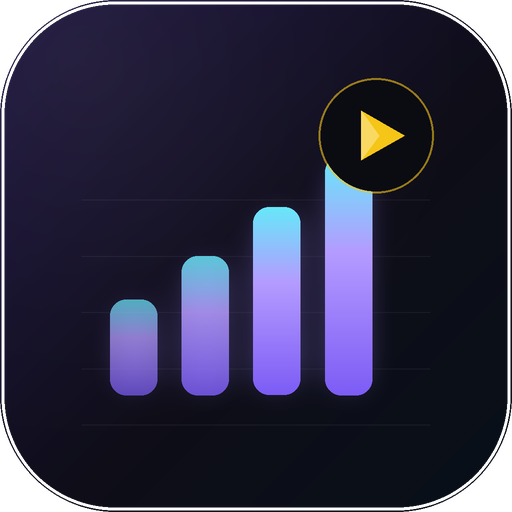

# StreamRank

A Stremio addon for the top movies and shows on **Netflix, Hulu, Disney+, Apple TV+, Paramount+, HBO Max and Prime Video** — with genre, decade/year, IMDb-rating and sort filters.

StreamRank adds 14 catalog rows (7 services × movies/shows) to Stremio Discover. Each row exposes filter dropdowns that Stremio renders natively, so you can narrow a row without editing any URLs. A small builder page also creates a custom install link with filters baked in.

**Live instance:** [streamrank-pgs1.onrender.com](https://streamrank-pgs1.onrender.com/) — install `https://streamrank-pgs1.onrender.com/manifest.json` in Stremio. The free Render instance sleeps after 15 minutes idle, so the first request may take about a minute to wake.

<p align="center">
  
</p>

## What you get

- **Seven services**: Netflix, Hulu, Disney+, Apple TV+, Paramount+, HBO Max, Prime Video.
- **Movies and shows** as separate catalog rows.
- **Native filters**: genre (19 genres), decade/year, minimum IMDb rating, and sort by Popular / Trending / IMDb Rating / Newest.
- **Custom boards**: choose services, media types, genre, exact year range, minimum rating and sort on the builder page. The resulting manifest has those filters baked in and a matching addon name.
- **IMDb IDs on every title**, so existing stream/metadata addons can resolve the same movie or show.
- **Caching and retries**: catalog pages are cached for 10 minutes by default; identical in-flight requests are coalesced; stale data is served if JustWatch is temporarily unavailable.
- No API key required.

## Quick start

Requires **Node.js 20.19+**.

```bash
cd stremio-streamrank
npm install
npm start
```

Open **http://127.0.0.1:7100/** and click **Install in Stremio** for the default board, or pick your filters and use the generated custom link.

The server listens on `0.0.0.0:7100` by default. The startup banner prints your LAN URL, which is useful when Stremio runs on another device.

### Install links

- Hosted board (works on any device): `https://streamrank-pgs1.onrender.com/manifest.json`
- Local board: `stremio://127.0.0.1:7100/manifest.json`
- Or paste `http://127.0.0.1:7100/manifest.json` into Stremio's addon search/install field.

Stremio on another **desktop** on the same network can use `http://<LAN-IP>:7100/manifest.json` (for example `http://192.168.1.20:7100/manifest.json`).

### Install on a TV

Stremio clients reject non-localhost **HTTP** addon URLs, so use the hosted HTTPS URL on a TV:

1. Open Stremio on the TV → **Add-ons** → **Add addon**.
2. Paste `https://streamrank-pgs1.onrender.com/manifest.json`.
3. Install it, then open **Discover** and pick a row such as **Netflix · Movies**.
4. Open the funnel icon for `Year`, `Rating` and `sort`; Genre is the dropdown beside the catalog picker.

Android TV and Fire TV generally expose URL-based addon install. Samsung/LG builds are more limited and may not accept a custom URL at all. StreamRank is catalogs/metadata only — the TV still needs a stream addon for playback.

> **Default vs custom board:** the default manifest keeps all filters editable inside Stremio Discover. A custom manifest bakes its filters into the catalogs and exposes only pagination, so it is best when you want a dedicated row such as “Netflix · Shows · Drama · 2015–2024 · 8.0+”.

## Filters

| Filter | Values | Applied |
| --- | --- | --- |
| Genre | Action, Animation, Comedy, Crime, Documentary, Drama, European, Family, Fantasy, Horror, History, Music, Reality, Romance, Sci-Fi, Sport, Thriller, War, Western | JustWatch server-side |
| Year | 2020s … 1960s, Before 1960 | JustWatch `releaseYear` server-side |
| Rating | 9.0+, 8.5+, 8.0+, 7.5+, 7.0+, 6.0+ | JustWatch `imdbScore.min` server-side |
| Sort | Popular, Trending, IMDb Rating, Newest | JustWatch `sortBy` |

Custom boards also accept an exact year range (for example 2015–2024). Every row paginates 50 titles at a time using Stremio's `skip` extra.

## Configuration

Environment variables (optionally in `.env`):

| Variable | Default | Purpose |
| --- | --- | --- |
| `PORT` | `7100` | HTTP port |
| `PUBLIC_URL` | *(request host)* | Public origin used in manifest/logo URLs, e.g. `https://streamrank.example.com` |
| `REGION` | `US` | Storefront region: `US`, `GB`, `CA`, `AU`, `NZ`, `DE` |
| `CACHE_TTL_MS` | `600000` | Catalog cache lifetime in milliseconds |
| `JUSTWATCH_ENDPOINT` | `https://apis.justwatch.com/graphql` | Override for testing |
| `JUSTWATCH_TIMEOUT_MS` | `12000` | Upstream request timeout |

Copy `.env.example` to `.env` if you want to change these. No third-party API key is needed.

### Remote access

To install from outside your LAN, put the addon behind HTTPS (Caddy, nginx, a tunnel, etc.) and set `PUBLIC_URL` to that origin. The manifest advertises `PUBLIC_URL/logo.png` and the install link must be reachable by the Stremio client.

## Host it online for free

See [DEPLOY.md](DEPLOY.md) for a no-card Render Blueprint, Google Cloud Run, Oracle Always Free and Cloudflare Workers options. The included [`render.yaml`](render.yaml) deploys the Dockerfile as a free Render web service; once deployed, share `https://<your-service>.onrender.com/manifest.json`.

This repo's live deployment is [streamrank-pgs1.onrender.com](https://streamrank-pgs1.onrender.com/). The Render service is connected to `main`, so pushing a commit redeploys it.

Free container hosts sleep after inactivity, so the first Stremio request after a quiet period may be slow or time out. Open the public URL once to wake the service, or use the keep-warm note in DEPLOY.md.

## Docker

```bash
docker build -t streamrank .
docker run --rm -p 7100:7100 -e PUBLIC_URL=https://streamrank.example.com streamrank
```

## Endpoints

| Endpoint | Description |
| --- | --- |
| `GET /manifest.json` | Default 14-row manifest |
| `GET /c/:token/manifest.json` | Custom manifest (base64url config token) |
| `GET /catalog/:type/:catalogId.json` | Catalog page, no filters |
| `GET /catalog/:type/:catalogId/:extra.json` | Catalog page with Stremio extras |
| `GET /c/:token/catalog/...` | Catalog page for a custom manifest |
| `GET /healthz` | Health and cache status |
| `GET /logo.png`, `/logo.svg` | Addon artwork |
| `GET /` | Builder/landing page |

Extras may be supplied as a Stremio path segment (`genre=Action&skip=50`) or as query parameters (`?genre=Action&skip=50`).

## Development

```bash
npm test          # unit tests (no network)
npm run smoke     # live checks against a running local server
npm run check     # syntax check entry modules
npm run logo      # regenerate public/logo.png (Pillow)
npm run verify:public -- https://streamrank-pgs1.onrender.com  # check a deployed instance
```

Project layout:

```
src/
  server.js        Express app, routes, CORS/PNA headers
  constants.js     services, genre codes, sort/year/rating options
  justwatch.js     JustWatch GraphQL client, cache, retry, stale fallback
  mapper.js        JustWatch node → Stremio meta preview
  manifest.js      default + configured manifests
  config-token.js  validate/encode/decode custom board config
  filters.js       parse Stremio extras and apply config filters
  landing.js       builder/landing page
  cache.js         TTL + LRU cache
public/            logo.svg / logo.png
scripts/           logo generator, live smoke test, filter probe
test/              node:test unit tests
```

## Notes and limitations

- Data comes from JustWatch's public, undocumented GraphQL endpoint. It can change; the client retries and serves stale cache when possible.
- Availability is region-specific. Set `REGION` to the storefront you actually use.
- Catalog rows show **50 titles per page**; Stremio's pagination continues through JustWatch's popular-title window (roughly the first 1,900 titles per filter).
- StreamRank supplies **metadata and catalog rows only** — no streams. Playback still comes from the stream addons you already use.
- IMDb ratings are the values JustWatch returns; some titles have no score.
- This project is not affiliated with Stremio, JustWatch or any streaming service. Use responsibly and respect the services' terms.

## License

MIT
